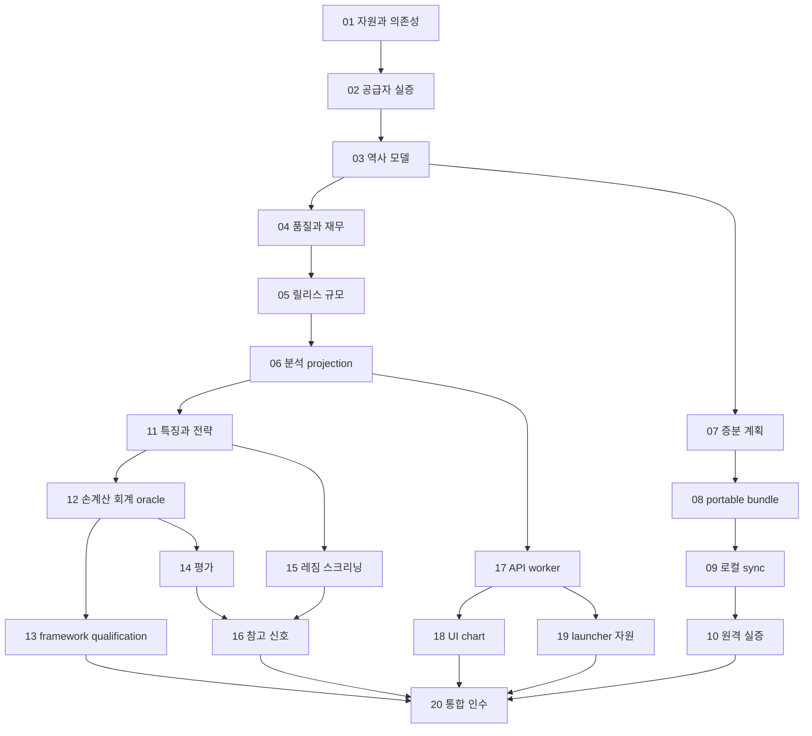

# 로컬 연구 플랫폼 구현 계획

> **For agentic workers:** REQUIRED SUB-SKILL: Use superpowers:subagent-driven-development or superpowers:executing-plans to implement this plan task-by-task. Delegation requires the applicable user and session instructions. Steps use checkbox syntax for tracking.

**Goal:** 기존 clean dataset 기반을 보존하면서 한국·미국 전종목 일봉·재무 연구, 레짐·스크리닝·참고 시그널, 무료 원격 갱신과 하루 5시간 이하 로컬 사용을 지원한다.

**Architecture:** PostgreSQL 기준 이력·가격 세션 reader·재무 PIT를 보존하고 Python plugin protocol/registry가 qualification된 framework adapter를 사용한다. FastAPI·React는 parameter·결과 UI를 제공한다. Actions·비공개 R2는 변경분만 전달하며 source는 고정한다.

**Tech Stack:** 기존 Python·PostgreSQL18·SQLAlchemy/Alembic 유지. FastAPI/Pydantic·React/TypeScript/Vite·Lightweight Charts. production framework는 18 비교의 Zipline-reloaded 우선·LEAN local 다음 qualification. vectorbt는 조건부 연구 도구, Parquet/DuckDB는 선택 캐시. 고급 수학은 interface만 둔다.

## 구현 시작 조건

이 계획은 문서 초안이며 구현 실행 지시와 구분한다. 설계 검토 후 아래 요청문으로 한 번의 구현 요청을 할 수 있다. 최소 수집 코드 공개 허용·비밀값 보호는 이미 확정됐으므로 반복 승인을 요청하지 않는다. 외부 계정·목적 repo·bucket·키·유료 예외처럼 실제 설정이 필요한 단계까지 코드·fixture·설정 예시·검증 결과를 준비한 뒤 필요한 항목만 제시한다. 현재 키가 있다고 출력하거나 외부 계정을 임의 생성하지 않는다.

17의 DEC-01–17과 G01–20을 적용한다. 자동 유료 이용0원·월합계10,000원 이내 제안만·source 자동 전환 금지·이번 작업 시간 제한 해제·일상 앱5시간 목표를 구분한다. 네 예시 전략을 제품 완료 기준으로 고정하지 않고 Python 확장 contract와 실제 extension probe를 인수한다.

기존 working tree에는 `docs/data/free-remote-update-local-sql.md`가 미추적 상태로 존재했다. 기존 수집기·SQL·키·사용자 파일을 보존한다. git dubious ownership을 만났을 때 필요하면 명령별 `git -c safe.directory='E:/side project/Backtest infra' ...`로 읽고 global 설정을 임의 변경하지 않는다.

## 의존 순서와 병행 가능한 작업



분리 가능한 작업도 shared schema·API contract를 먼저 고정한다. 실제 delegation을 선택한 경우 파일 소유권을 나누고 다른 작업자의 변경을 되돌리지 않는다. full coverage가 외부 소스로 막히면 UI·계산 fixture·부분 연구 개발은 계속할 수 있으나 strict/전체 완료를 통과한 것으로 표시하지 않는다.

## 공통 작업 규칙

각 task는 의미 있는 회귀 fixture 작성→실패 확인→최소 구현→단위/SQL/API 검증→diff와 계약 review→작은 commit 순서다. 기존 모델의 clock·immutable·release를 바꾸는 수정은 기존 회귀 suite를 실행한다. 문서·색상 같은 낮은 영향 변경에 구현을 그대로 복제한 테스트를 만들지 않는다.

각 task 종료에 생성/수정 파일·명령·결과·실데이터 probe·gap·다음 의존성을 `docs/data/platform-implementation-status.md`에 기록한다. 신규 검증 명령은 해당 task가 구현된 이후에만 사용할 수 있다. 현재 존재하지 않는 명령을 이미 동작하는 명령으로 설명하지 않는다.

상태 기록은 implementation·data_readiness·operation·result를 분리한다. fixture만으로 운영 연결을 완료 처리하거나 stub/demo를 성공 응답으로 넣지 않는다. 필수 기능 not_applicable·임의 scope 축소·기대값 완화·과금 예외 자동 적용은 금지한다. 데이터 차단이 생겨도 영향 없는 코드/진단/UI 개발은 계속한다.

19의 실제 사례와 T43–T49를 적용한다. Task06의 작은 실데이터 projection이 준비되면 최소 Task17/18의 SQL→API→차트 경로부터 인수하고, 이후 기능을 같은 경로에 확장한다. 전체 Task 번호를 기계적으로 끝까지 진행한 뒤 처음 통합하지 않는다. 이 표본 검증은 한국/미국 전체 target·10년 이상 보관 목표를 축소하지 않는다. source completion·job 정상 종료·일부 결과와 전수 data quality를 별개로 보고하며 부족 구간만 bounded 복구 큐로 재개한다.

20의 단계 연결·확장 계약을 작은 기존 DTO/registry/Python 함수로 구현한다. DEC-18/19의 단순성·전략 진입 풀을 적용하고 DEC-20–23은 답변 전까지 기존 기본안이며 새 기능을 임의 초기 필수로 확대하지 않는다. 새 scheduler·workflow 엔진·원격 분석 서버를 만들지 않는다.

### Task 01 자원 조사와 의존성 실증

**Files:** Create `scripts/inspect-resources.ps1`, `config/research-defaults.yaml`, `docs/data/platform-environment.md`; Modify `pyproject.toml` only after compatibility results; Create `frontend/package.json` and lock during frontend bootstrap.

- [ ] CPU/RAM/호스트 디스크와 Docker/WSL volume 위치·SQL table/raw/cache 크기를 읽고 기록한다. C 여유와 실제 DB 위치를 먼저 확인한다.
- [ ] 기존 수집 환경을 변경하지 않는 venv에서 FastAPI·dataframe·Numba·vectorbt 호환과 wheel을 실증한다. 실패하면 research 환경 분리를 문서화한다.
- [ ] local window 240/300분·worker1·thread4·동적 RAM·클라우드 기본값을 하나의 config로 고정한다. secret은 기존 credentials 경로로 분리한다.
- [ ] scope-lock과 method/feature manifest에 필수 확장 platform·framework·data/API/UI/sync, 선택 cache/연구 도구, 제외된 고급 수학을 명시한다. 비용·RSS/time·의존성·실제 engine 지원을 기록하고 자동 유료 경로를 검사한다.
- [ ] smoke import·최소 분석·frontend build를 실제 실행하고 lock·라이선스·source 버전 기록을 남긴다.
- [ ] 후보 framework의 무료 설치·own-data 최소 실행 probe를 초기에 확인한다. 상세 회계 qualification은 Task13이며, 설치/import만으로 engine 확정을 보고하지 않는다.

### Task 02 역사 소스와 무료량 qualification

**Files:** Create `docs/data/platform-source-qualification.md`, `src/backtest_data/history/source_inventory.py`, `tests/unit/test_history_source_inventory.py`.

- [ ] KR/US 각각 현재·상폐·정지·티커 변경·ETF/ETN·split/dividend 사례를 고정한 조사 manifest를 만든다. 수집 target 전체를 바꾸지 않는다.
- [ ] KIS·Alpaca·KRX·SEC·DART와 history/action/product 후보의 실제 접근·범위·이용 조건·10년 이상 가능 구간을 확인한다. 키 없는 provider는 configured=false로 남긴다.
- [ ] 공급자 응답 clock·identity·상품·action/terminal event 근거를 SQL source qualification에 연결한다.
- [ ] dual-market 일회 증분의 calls/seconds/bytes를 실측한다. 부족 소스는 gap과 복구 후보로 남기고 무료 완전성을 선언하지 않는다.

### Task 03 역사 identity와 상품 거래상태

**Files:** Create `src/backtest_data/history/models.py`, `identity.py`, `tradability.py`, `products.py`, `collection.py`, `calendar_collection.py`, one Alembic revision, `tests/unit/test_historical_universe.py`, `tests/integration/test_history_sql.py`, `test_calendar_collection.py`.

- [ ] ticker 재사용·상폐·재상장·보통/우선·ADR·ETF·ETN·공식 정지와 0거래 공급자 보고 fixture를 만든다.
- [ ] 10 데이터 계약의 listing/lifecycle/tradability/product 테이블과 assertion/withdrawal 선택을 구현한다.
- [ ] 기존 ID·alias·target manifest와 연결하고 당시 universe를 cutoff로 조회한다. ambiguous identity를 차단한다.
- [ ] Task02에서 적격성을 확인한 source의 실제 lifecycle·product·tradability·calendar 수집을 구현해 SQL에 적재한다. source version·공개/효력·휴장·조기종료·DST를 보존하고 조회/증분 planner에 연결한다. 확보 불가는 명시 coverage gap이다.
- [ ] migration replay·동일 source 재처리·earlier cutoff·기존 sealed release 불변을 실제 PostgreSQL에서 검증한다.

### Task 04 품질 분모와 재무 개선 입력

**Files:** Create `src/backtest_data/quality/models.py`, `coverage.py`, `eligibility.py`, `reconciliation.py`, `src/backtest_data/prices/action_collection.py`; extend source-qualified action adapter in `prices/action_adapters.py`; Modify targeted `fundamentals/basis.py`, `derive.py`, `materialize.py`, `metric_policy.py` and `releases/query_context.py` only with versioned registry changes; Create `tests/unit/test_feature_eligibility.py`, `tests/integration/test_platform_coverage.py`, `test_corporate_action_collection.py`.

- [ ] requested/eligible/not_applicable/missing/unsupported/quarantined와 상품 적용성 fixture를 작성한다.
- [ ] fiscal·CFS/OFS·YTD→Q·TTM·정정·단위·양수 비교 기준을 existing derivation으로 연결한다. 근거 없이 fiscal date를 채우지 않는다.
- [ ] revenue_yoy·margin delta·turnaround의 공개 clock·lineage·status를 평가할 수 있게 만든다.
- [ ] 신규 financial definition·quality registry는 새 policy hash/version으로 등록한다. 기존 definition hash·봉인 membership을 보존하고 이전 release를 새 규칙으로 재해석하지 않는다.
- [ ] raw/canonical/derived row counts와 실제 지표 coverage를 각각 보고하고 capture-only 소급 차단을 검증한다.
- [ ] 검증된 source의 split/dividend/terminal action을 실제 수집·SQL 적재·정정 discovery하고 가격과 대조한다. action coverage·terms·effective/published clock을 adjusted projection과 ledger에 연결한다. unknown 권리/청산은 unsupported로 남긴다.

### Task 05 릴리스와 읽기 규모 확장

**Files:** Modify `src/backtest_data/releases/build.py`, `query.py`, `validation.py` with bounded helpers; Create `tests/integration/test_streaming_release.py`, `docs/data/platform-capacity.md`.

- [ ] 100만 행 경계를 넘는 bounded synthetic dataset와 small fixed real release로 기존 실패/메모리·조회시간을 측정한다.
- [ ] immutable membership·closure hash·policy를 유지하는 partitioned streaming build/read를 구현한다. 새로운 release policy version이 필요하면 별도로 고정한다.
- [ ] freeze 중 source 정정·raw 누락·잘못된 shard hash·partial restart에서 integrity fail 또는 안전 재개를 검증한다.
- [ ] 기존 v5 reader와 신규 format의 compatibility·cold/warm·RSS를 기록한다. 이전 release를 새 version으로 임의 해석하지 않는다.

### Task 06 분석 projection과 캐시

**Files:** Create `src/backtest_data/projections/contracts.py`, `repository.py`, `price_session_reader.py`, `cache.py`, `research_only.py`; Create `src/backtest_research/contracts.py`; Test `tests/unit/test_dataset_contract.py`, `tests/integration/test_release_projection.py`, `test_price_session_clock.py`.

- [ ] future publication·current ticker·capture-only·수정주가 action cutoff·null→0 오류 fixture를 먼저 만든다.
- [ ] AnalysisDataset manifest·scope·quality·clock schedule·bounded bars/fundamentals adapter를 구현한다.
- [ ] 필요한 경우 disposable Parquet cache를 추가하고 key·closure·범위 hash·재생성을 검증한다. DuckDB 도입은 benchmark 개선 시에만 한다.
- [ ] 재무는 공개 버전 PIT를 탐색에서도 강제하고, 가격은 신규 historical_price_session_v1·analysis_price_query_v1로 읽는다. 기존 reader/봉인 clock을 바꾸지 않는다. 2018봉의 2026수신은 허용하지만 미래 봉/fit/조정의 과거 유입은 차단한다.
- [ ] 검증/탐색 등급·source-defined series·qualification gaps·price basis·revision·data_origin을 actual-source manifest와 API/export에 보존한다. 사용자 selected를 validation 완료로 변환하지 않는다.

### Task 07 날짜 증분과 정정 계획

**Files:** Create `src/backtest_data/ingestion/incremental.py`; Modify `jobs.py`, `supervisor.py`, `cli.py` narrowly; Test `tests/unit/test_incremental_intervals.py`, `tests/integration/test_incremental_planner.py`.

- [ ] 휴일·미국 DST·월말·이미 수집된 gap·new filing·amendment·provider downtime fixture를 만든다.
- [ ] covered intervals+target+calendar로 새 날짜·공시·정정 work identity를 생성한다. existing incremental 큐 재개와 자동 계획을 명령/상태에서 구분한다.
- [ ] live·correction·backfill fairness와 provider budget을 유지한다. 요청 기간을 짧게 잘라 성공 coverage로 바꾸지 않는다.
- [ ] 동일 planner 재실행 새 중복 job 0개, 실패 이후 동일 구간 재개, KR/US KIS 공유 예산을 검증한다.

### Task 08 portable state와 bundle

**Files:** Create `src/backtest_data/ingestion/portable_state.py`, `src/backtest_data/sync/contracts.py`, `bundle.py`, `dependencies.py`; Test `tests/unit/test_bundle_contract.py`, `tests/integration/test_portable_state.py`.

- [ ] 10 명세의 manifest·Decimal·null·clock·parent refs·ID collision fixture를 만든다.
- [ ] catalog/job subset을 임시 SQL로 복원하고 기존 collector가 이어서 처리할 수 있는 adapter를 구현한다. 전체 DB 복제를 하지 않는다.
- [ ] fresh delta·checkpoint_after·필수 raw dependencies를 export하고 size/hash/path/schema allowlist를 검증한다.
- [ ] 임시 SQL round-trip에서 원 ID·capture·fencing·unfinished interval이 유지되고 token·password가 export되지 않음을 확인한다.

### Task 09 로컬 transport와 transactional sync

**Files:** Create `src/backtest_data/sync/models.py`, `folder_transport.py`, `importer.py`, `receipts.py`; one Alembic revision; Test `tests/integration/test_sync_idempotency.py`, `test_sync_failures.py`.

- [ ] 순서 변경·duplicate·missing parent·file corruption·SQL failure·ack failure fixture를 만든다.
- [ ] raw atomic write→SQL FK-order append→sync receipt commit→validation→backup inclusion 순서를 구현한다.
- [ ] local visibility clock을 import receipt로 구분한다. capture를 import 시각으로 바꾸지 않는다.
- [ ] 동일 batch 두 세션 재처리·재시작에서 새 fact 0개, 충돌 content fail, 미완료 cursor 미전진을 확인한다.

### Task 10 R2와 Actions 원격 실증

**Files:** Create `src/backtest_data/sync/r2_transport.py`, `remote_owner.py`, `scripts/run-remote-collector.py`, `.github/workflows/collector-template.yml`, `docs/data/platform-remote-setup.md`; Test `tests/integration/test_remote_commit_protocol.py`.

- [ ] 먼저 fake/object-store contract fixture로 ETag CAS·lease expiry·orphan·head 응답 소실·budget reservation을 검증한다.
- [ ] transient PostgreSQL·portable state·provider collector·bundle commit·checkpoint restoration을 한 유한 실행으로 연결한다.
- [ ] workflow template는 Secrets 이름·timeout·concurrency·최소 permissions·pinned actions·공개 로그 redaction을 포함한다. fork PR에서 Secrets 실행을 허용하지 않는다.
- [ ] 사용자 선택한 최소 공개 코드만 별도 공개 대상 후보로 준비한다. 현재 repo 공개 전환·키 업로드·R2 생성은 설정 review 후 수행한다.
- [ ] 실제 endpoint에서 manual run→local sync→backup ack→remote retry/restart를 검증한 뒤 schedule을 활성화한다. 각 단계 사용량·미수신 closure를 기록한다.

### Task 11 특징과 Python 전략 확장

**Files:** Create `src/backtest_research/features/prices.py`, `fundamentals.py`, `registry.py`; Create `strategies/protocol.py`, `registry.py`, `examples/`; Test `tests/unit/test_platform_features.py`, `test_strategy_extension.py`, `test_strategy_state.py`.

- [ ] 11 명세의 SMA·12−1·Wilder RSI2·vol·fiscal 성장·마진·turnaround를 hand-calculated fixture로 검증한다.
- [ ] definition hash·parameter registry·warmup·three-valued missing·input lineage를 구현한다.
- [ ] 09의 StrategySpec·decide·state/portfolio DTO·config schema·data policy·capabilities를 구현한다. 가격/재무·stateful 예시로 실제 등록/실행을 검증하고 새 Python plugin을 core 수정 없이 추가한다. 예시 네 개가 전체 제품이라는 UI/registry를 만들지 않는다.
- [ ] signal-only 모의거래는 명시 sizing policy를 요구한다. 실패를 기본 동일비중·다른 예시 전략으로 바꾸지 않는다. Model/Feature 확장 interface는 만들되 고급 방법은 연결하지 않는다.
- [ ] 미래 bar·공시를 append해 이전 feature/target이 바뀌지 않는 prefix invariance를 검증한다.
- [ ] 동일 EvaluationContext·Python pool selector·definition bundle을 historical/current에 공유한다. 기본 입력 검사와 필요한 전략의 작은 entry/exit 옵션·target 범위를 구현하고 후보 제외/생략을 자동 청산으로 해석하지 않는다.
- [ ] checkpoint의 처리 세션·input prefix·의존 refs를 검증해 미래만 추가된 새 release는 증분 처리하고 과거 정정은 유효 checkpoint/영향 시점부터 재생한다. dataset ID 변경만으로 매일 전체 재생하지 않는다.

### Task 12 손계산 회계 oracle와 execution 계약

**Files:** Create `tests/oracles/ledger.py`, `src/backtest_research/engines/base.py`, `costs.py`, `execution_policy.py`; Test `tests/unit/test_ledger_oracle.py`, `test_execution_constraints.py`.

- [ ] tiny 2종목 10세션 fixture에서 익일 시가·cash 부족·정수 주식·fee·slippage·미체결·배당·분할의 cash/qty/NAV를 손계산한다.
- [ ] 사건→익일 주문→매도→매수→mark→폐장 신호의 기대 계약을 고정한다. oracle는 검증 도구이고 production 자체 엔진으로 사용하지 않는다. tax/cost는 versioned 입력이다.
- [ ] 상폐·reverse split fractional·unsupported corporate action을 기본으로 차단하고 unresolved event를 기록한다.
- [ ] raw 가격+현금배당과 조정 feature를 분리하고 double-count·same-close fill·future liquidity sizing을 차단한다.
- [ ] DEC-17의 research_daily_tradability_v1을 별도 구현한다. 관측 unknown·가정·사후 체결 입력을 분리하고 confirmed halt·zero/missing volume·invalid open/action 및 strict 경로 자동 전환을 차단한다.

### Task 13 무료 framework qualification과 adapter

**Files:** Create `src/backtest_research/engines/capabilities.py`, `qualification.py`, selected `<framework>_adapter.py`; Test `tests/unit/test_engine_parity.py`, `tests/integration/test_framework_plugin.py`; Create `docs/data/platform-framework-qualification.md`; Update environment lock.

- [ ] 18의 Zipline-reloaded 우선·LEAN local 다음으로 own data/Python/Windows·KR/US·calendar·split/dividend/정지/상폐·next-open·cash/lot를 동일 oracle와 비교한다. 문서 비교와 실제 실행을 구분한다.
- [ ] SQL snapshot→cache→plugin→result/ledger→API/export를 검증한다. fill-forward·adjustment·pay-date·auto-close가 계약을 바꾸면 override 또는 unsupported로 처리한다.
- [ ] free local path·tag/commit/license·지원 matrix·time/RSS·재시작을 통과한 engine만 default로 lock한다. 선택 미완료·미지원은 명시 실패이며 runtime engine fallback은 없다.
- [ ] paid LEAN CLI·PRO·데이터 구매·자작 production engine로 자동 이동하지 않는다. 후보 전부 실패 시 월합계1만원 이내 유료 대안 또는 무료 설계 대안을 근거와 함께 제안만 한다.
- [ ] vectorbt가 별도 가속에 유용하면 선택 adapter를 추가하고 parity를 검증한다. 도입하지 않은 adapter의 연동 완료를 주장하지 않는다.

### Task 14 지표와 시간순 검증

**Files:** Create `src/backtest_research/evaluation/metrics.py`, `splits.py`, `walk_forward.py`, `validation.py`; Test `tests/unit/test_metrics_and_splits.py`, `tests/integration/test_research_reproducibility.py`.

- [ ] CAGR·drawdown·turnover·cost·null denominator·동일 benchmark·fold overlap fixture를 만든다.
- [ ] frozen eval plan·train-only fit·warmup·trial history·seed·run fingerprint·holdout use count를 저장한다.
- [ ] data quality·재무 PIT·가격 세션·비용·평가 scope를 보고하고 selected와 validation을 독립 저장한다. 수익률이나 테스트 통과로 전략을 자동 선택하지 않는다.
- [ ] same fingerprint 핵심 결과 일치, 전체기간 최적화의 holdout 누출 차단, 분리 test 합산을 검증한다.

### Task 15 시장 레짐과 두 스크리너

**Files:** Create `src/backtest_research/regimes/rules.py`, `models.py`; Create `screening/stocks.py`, `strategies.py`, `ranking.py`; Test `tests/unit/test_causal_regimes.py`, `test_screening_ranks.py`.

- [ ] SMA200·20vol·past756 quantile·3세션 확정·unknown·시장 proxy fixture를 만든다.
- [ ] stock/strategy screening batch·eligible/excluded·stable tie-break·config hash를 저장한다.
- [ ] 가격·재무 모멘텀·평균회귀 열을 분리하고 레짐별 전략 표본·비용·OOS를 표시한다.
- [ ] future prefix invariance·null rank·상품 applicability·동일 config 재현을 검증한다. HMM은 초기 필수 작업이 아니다.
- [ ] 스크리너가 전략별 진입 풀을 표시하도록 같은 selector/schedule을 재사용한다. rank 모집단·보유 관리·레짐의 display/entry/allocation/exit 역할을 명시하고 definition bundle을 고정한다.

### Task 16 수동 원장과 참고 시그널

**Files:** Create `src/backtest_app/portfolios/models.py`, `service.py`; Create `src/backtest_research/signals/service.py`, `gates.py`, `expiry.py`; Test `tests/unit/test_signal_gates.py`, `tests/integration/test_signal_lineage.py`.

- [ ] actual_user_recorded와 simulated snapshot·stale 원장·반대 전략·정정·expiry fixture를 만든다.
- [ ] 사용자 selection 이벤트·portfolio journal·signal batch/event·supersession을 SQL에 추가한다. 모든 새 plugin은 research, 사용자 최종 선택만 selected다.
- [ ] 같은 definition의 재무 PIT·가격 clock·freshness·tradability·portfolio gate를 적용한다. 연구 신호와 selected 결과를 분리하고 선택을 품질/성과 인증으로 바꾸지 않는다.
- [ ] app·CSV의 state 일치, generation 멱등성·old signal 불변·주문 API 부재를 확인한다.

### Task 17 로컬 API와 worker queue

**Files:** Create `src/backtest_app/main.py`, `api/`, `repositories/`, `jobs/models.py`, `jobs/runner.py`; Test `tests/integration/test_platform_api.py`, `test_app_job_claims.py`.

- [ ] 12 명세 DTO·decimal·aware time·cursor·error·idempotency·Origin·loopback fixture를 작성한다.
- [ ] bounded GET과 비동기 POST를 구현한다. heavy computation은 API process에서 수행하지 않는다.
- [ ] claim/heartbeat/fencing·pause/resume/cancel·progress·lease recovery를 PostgreSQL로 구현한다.
- [ ] 중복 worker·restart·schema mismatch·invalid scope·secret redaction을 검증한다. 임의 SQL·URL·주문 실행 endpoint는 만들지 않는다.

### Task 18 React 앱과 금융 차트

**Files:** Create `frontend/src/api/`, `pages/`, `components/charts/`, `components/quality/`, `app/`; Test `frontend/src/**/*.test.tsx`, `frontend/e2e/platform.spec.ts`.

- [ ] 홈·종목·차트·실험·스크리너·시그널·수동 원장·설정의 API fixtures와 빈/오류/부분 상태를 준비한다.
- [ ] 운영 build는 실제 API/SQL만 사용한다. demo/mock·랜덤·고정 성공 응답은 tests/dev로 분리하고 production 거부를 검증한다. UI는 Python plugin/parameter를 제공하며 조건 조합 builder는 만들지 않는다.
- [ ] chart adapter·pagination·query cache·crosshair·indicator·volume·event markers·basis switch를 구현한다.
- [ ] quality·currency·세션·PIT/연구 한계·expired/conflict를 결과 가까이에 표시하고 로컬 build 자산을 제공한다.
- [ ] 키보드·1920/1280 layout·chart cleanup·network offline·CSV 상태를 검증한다. NOTICE와 링크를 포함한다.

### Task 19 launcher와 resource window

**Files:** Create `scripts/start-local.ps1`, `stop-local.ps1`, `src/backtest_app/resources.py`; Test `tests/unit/test_resource_windows.py`; Create `docs/data/platform-local-runbook.md`.

- [ ] KST 날짜 경계·누적 wall-clock·busy RAM·disk reserve·worker ownership fixture를 만든다.
- [ ] launcher는 health·PID identity·실행 환경·thread caps·existing services를 확인하고 브라우저를 연다. 중복 시작은 reuse한다.
- [ ] 240분 신규 heavy job cutoff와 300분 cooperative pause·checkpoint를 구현한다. OS 자동 종료·기존 외부 process kill은 하지 않는다.
- [ ] 앱 종료/작업 pause/서비스 stop의 차이와 current collector 인계 절차를 실제 재시작으로 검증한다.

### Task 20 전수 간극 기록과 통합 인수

**Files:** Create `tests/integration/test_platform_end_to_end.py`, `docs/data/platform-acceptance-report.md`, `platform-recovery-runbook.md`; Update status docs only for verified results.

- [ ] 15의 T01–T56 중 확정된 초기 scope 전부를 fixture·고정 실데이터·실제 API/SQL·remote smoke로 확인한다. G01–20·extension·비용·금지 fallback·단계 연결 증거를 포함한다.
- [ ] 실제 full target denominator·field/session coverage·원격 사용량·RAM/disk·cold/warm 조회를 기록한다.
- [ ] T43–T49의 SQL 역사 보존·최소 오류 격리·구조화 부분 완료·역사 universe·stateful 재시작·오래된 결과 표시·연구용 체결 가정을 실제 경로에서 검증한다. 최근756봉/8분기 캐시를 원본 보관 상한으로 사용하지 않는다.
- [ ] 새 임시 DB+raw root에 전체 필요한 evidence·research·portfolio를 복원하고 signal·run fingerprint를 재확인한다.
- [ ] 요구별 pass/blocked/not_applicable·증거·gap·복구 후보를 보고한다. 외부 역사 데이터 부족과 실제 구현 누락을 구분한다.
- [ ] runtime·tests·docs·diff review 후 실행 가능한 local app·launcher·사용 가이드·미완료 목록을 전달한다.

### 범위 밖 후속 참고 고급 수학 방법론

사용자 DEC-13에 따라 이번 Task01–20에는 고급 수학 방법을 연결하지 않는다. Strategy/Feature/Model protocol·clock/unit/artifact/capability extension만 구현한다. HMM·Kalman·고급 최적화·추가 학습은 별도 후속 요청 범위이며 초기 완료 조건·dependency·자동 실행에 넣지 않는다.

## 예정 검증 명령

다음은 관련 파일과 dependencies가 구현된 이후의 검증 예시다. 문서 작성 시 이 신규 테스트가 실행됐다는 뜻은 아니다.

```powershell
.venv/Scripts/python.exe -m pytest tests/unit -q -p no:cacheprovider
.venv/Scripts/python.exe -m pytest tests/integration -q --require-postgres -p no:cacheprovider --basetemp artifacts/platform-tests
.venv/Scripts/python.exe -m compileall -q src
npm --prefix frontend run typecheck
npm --prefix frontend run test
npm --prefix frontend run build
npm --prefix frontend run test:e2e
```

테스트 DB는 기존 방식처럼 개발 데이터와 분리한다. 자동 network/live tests는 키·사용량·source qualification이 준비된 범위에서 명시적으로 실행한다. 수정이 없는 문서 작업에서는 전체 runtime suite를 불필요하게 재실행하지 않는다.

## 한 번의 구현 요청문

```text
docs/planning/2026-10-09-local-research-platform/00-overview.md부터 20까지의 문서를 읽고,
확정된 답변과 미확정 기본안을 구분해 Task 01–20을 의존 순서대로 구현해줘.
기존 수집기·PostgreSQL·원관측·봉인 release·키·다른 변경을 보존하고,
한국·미국 전종목·ETF·ETN·상폐·정지와 10년 이상 목표 분모를 줄이지 마.
일봉·장 마감 후 참고 신호와 Python 전략 확장 플랫폼을 만들어줘. 초기 스타일 예시를 고정 전략 목록으로 만들지 마.
자동 주문은 만들지 말고 일상 앱은 5시간 사용 목표로 checkpoint/pause해줘. 이번 구현·검증은 시간 때문에 중단하지 마.
무료 원격 실행은 최근 Actions+비공개 R2 설계에 맞춰 먼저 로컬·fixture·manual smoke를 준비해줘.
공개 범위·계정 설정·키·비용이 필요한 단계는 구체적인 설정과 검증 결과를 준비한 뒤 필요한 선택만 요청해줘.
모든 요구를 15 인수표에 연결하고 실제 확보 불가·PIT 미검증은 gap/blocked로 남겨줘.
각 단계에서 필요한 테스트와 복구 검증을 완료하고, 최종 launcher·앱·운영가이드·인수보고서를 제공해줘.
17의 DEC-01–17/G01–20과 18 프레임워크 비교를 적용하고 실제 qualification된 framework만 기본 engine으로 고정해줘.
자동 유료 이용은 0원, 월합계 1만원 이내 대안은 제안만 하고 사용자 확인 후 이용 여부를 결정해줘.
가격은 해당 세션까지만, 수신 날짜는 감사용으로 처리하고 재무는 당시 공개 버전 PIT를 강제해줘.
source/engine 자동 fallback·가짜 화면·정의 축소·scope 축소·fixture만으로 운영 완료를 선언하는 것을 금지해줘.
모든 전략은 연구로 시작하고 연구 신호를 별도 표시해줘. 최종 선택은 사용자만 하며 validation을 자동 승격하지 마.
고급 수학은 확장 interface만 남기고 이번에는 연결하지 마.
19의 실제 사례와 T43–T49를 적용해 가격/재무 SQL 역사 삭제·전체 재시도·상태 초기화·오래된 신호 재활성화를 막아줘.
DEC-17의 연구용 거래가능 가정을 허용하되 unknown 관측은 보존하고 실제 체결 증거로 인증하지 마. 체결 세션의 사후 거래량을 과거 신호나 sizing에 미리 사용하지 마.
20의 작은 연결 계약과 T50–T56을 적용하고, 전략별 풀은 진입 판단 풀로 써줘. 보유 관리는 풀 밖에서도 이어가고 생략 target을 자동 청산으로 바꾸지 마.
같은 context의 historical/current 판단과 정의 bundle을 공유해줘. 범용 workflow나 초기 고급 모델은 만들지 마.
DEC-20–23이 pending이면 관련 범위를 임의 확대하지 말고 기존 기본안을 사용하며, 실제 필요한 결정은 구체적으로 요청해줘.
```
